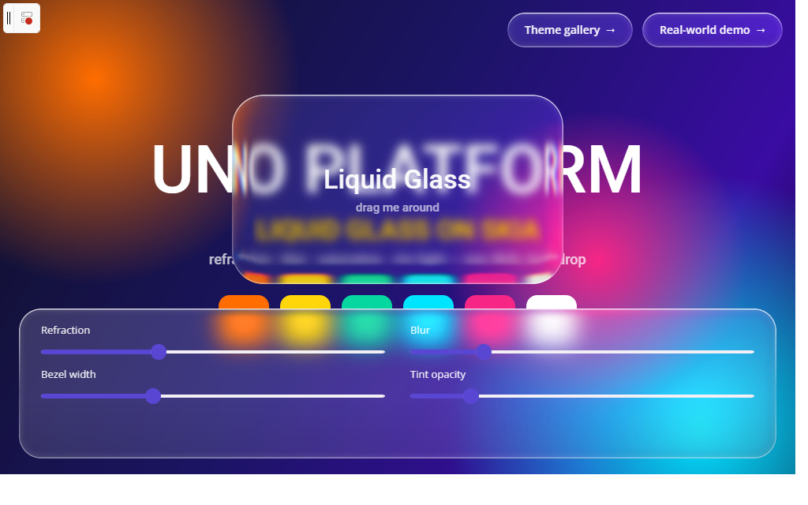
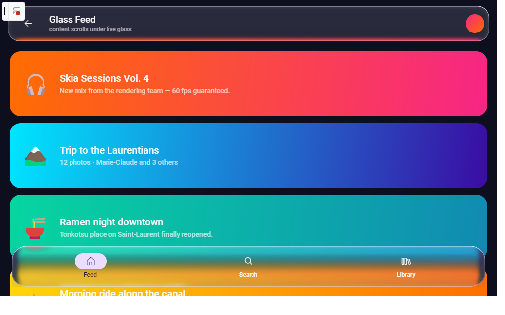
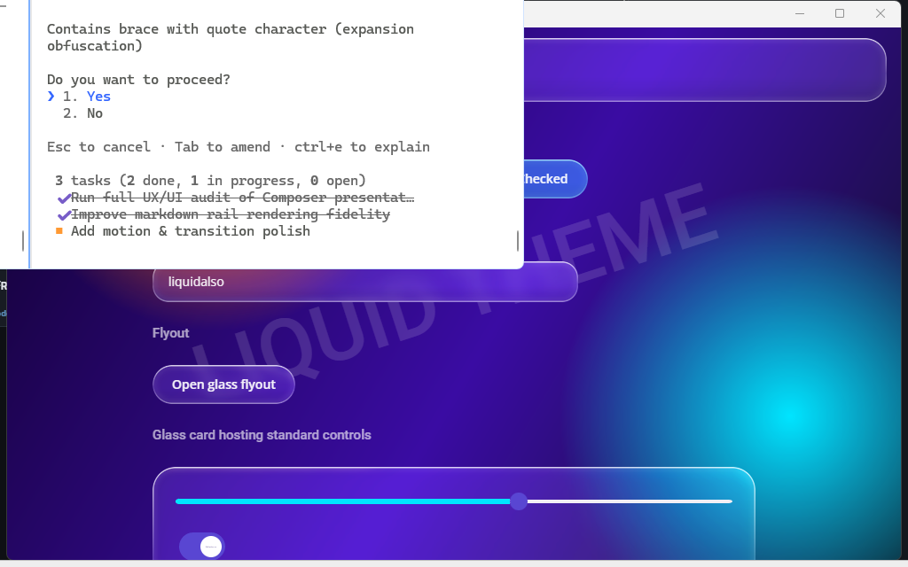

# LiquidGlassLab

Apple-style **Liquid Glass** for Uno Platform, rendered live on the Skia renderer. Glass surfaces refract, blur, and saturate whatever the app has painted behind them — live content, no static snapshots, no platform-specific effect APIs. One C# control, one XAML theme, works on every Skia-rendered target.



This repo is a lab: it proves the technique, wraps it into reusable pieces, and demos them in realistic UI. Read this top to bottom and you should understand every moving part well enough to extend it.

## Project map

| Piece | File | Role |
|---|---|---|
| **`LiquidGlassView`** | [Controls/LiquidGlassView.cs](LiquidGlassLab/Controls/LiquidGlassView.cs) | The effect itself. An `SKCanvasElement` that backdrop-samples and re-renders what's behind it. All the Skia/SkSL work lives here. |
| **`LiquidGlassPanel`** | [Controls/LiquidGlassPanel.cs](LiquidGlassLab/Controls/LiquidGlassPanel.cs) | Templated `ContentControl`: glass behind, your content in front, one tag. This is what app code should use. |
| **`LiquidTheme.xaml`** | [Styles/LiquidTheme.xaml](LiquidGlassLab/Styles/LiquidTheme.xaml) | Glass styles for standard controls: `LiquidButtonStyle`, `LiquidToggleButtonStyle`, `LiquidTextBoxStyle`, `LiquidFlyoutPresenterStyle`, plus the `LiquidGlassPanel` default template. |
| **MainPage** | [Presentation/MainPage.xaml](LiquidGlassLab/Presentation/MainPage.xaml) | The lab bench: a draggable glass card over animated background art, with sliders (themselves on glass) tuning every effect parameter live. |
| **GalleryPage** | [Presentation/GalleryPage.xaml](LiquidGlassLab/Presentation/GalleryPage.xaml) | Theme gallery: every themed control on real glass, including a glass flyout (popup layer). |
| **SecondPage** | [Presentation/SecondPage.xaml](LiquidGlassLab/Presentation/SecondPage.xaml) | "Glass Feed" — the real-world shape: a scrolling feed running under a pinned glass header and a glass bottom `TabBar` (Uno Toolkit). |

| Theme gallery | Glass feed | Glass flyout |
|---|---|---|
|  |  |  |

## How the effect works

`LiquidGlassView` subclasses **`SKCanvasElement`** (`Uno.WinUI.Graphics2DSK`, pulled in automatically by the `SkiaRenderer` Uno feature). On Skia targets, `SKCanvasElement.RenderOverride` draws on *the same canvas the window renders to*, with everything behind the element already painted. That single fact is what makes a true backdrop effect possible:

1. **Clip** to a rounded rect (the glass shape).
2. **`canvas.SaveLayer(in SKCanvasSaveLayerRec { Backdrop = filter })`** — SkiaSharp 3.119's binding of `SkCanvas::SaveLayerRec`. The backdrop filter chain re-initializes the layer from the already-painted content behind the element:
   - **Blur** — `SKImageFilter.CreateBlur`.
   - **Refraction** — `SKImageFilter.CreateDisplacementMapEffect`, displaced by an **SkSL runtime shader** (`SKRuntimeEffect` + `SKRuntimeShaderBuilder` → `SKImageFilter.CreateShader`). The shader computes a rounded-rect SDF; its gradient gives the outward normal, and a smoothstep ramp across a bezel band gives the lens profile. RG-encoded as `0.5 + n * 0.5`.
   - **Chromatic aberration** (optional) — the displacement is applied three times at per-channel scales (red bends more, blue less), each isolated by a color matrix, recombined with arithmetic compose filters.
   - **Saturation boost** — color-matrix `SKColorFilter`, the "vibrancy" part of the Apple look.
3. **Chrome on top** — tint wash, bottom shade gradient, a gradient rim stroke (bright top, dim bottom), and a soft inner glow.

SkiaSharp 3.119 has no binding for `SkImageFilters::RuntimeShader`, so the SkSL shader can't process the backdrop directly — routing it through the displacement-map filter as the *displacement input* is the workaround, and it's also cheaper (the shader is evaluated once per pixel as a plain shader).

Because the backdrop re-resolves on every window recompose, the glass stays live for free: drag the card, scroll the feed, animate the background — no manual `Invalidate()` needed for motion *behind* the glass.

## The reusable layer

App code never touches `LiquidGlassView` directly. The intended surface is:

```xml
<!-- content on glass: one tag -->
<controls:LiquidGlassPanel GlassCornerRadius="24" RefractionStrength="26"
                           BezelWidth="20" BlurRadius="10" TintOpacity="0.12"
                           Padding="24,18">
  <StackPanel> ... </StackPanel>
</controls:LiquidGlassPanel>

<!-- standard controls, glass-skinned -->
<Button Content="Glass button" Style="{StaticResource LiquidButtonStyle}" />
<ToggleButton Style="{StaticResource LiquidToggleButtonStyle}" />
<TextBox Style="{StaticResource LiquidTextBoxStyle}" />
```

`LiquidTheme.xaml` is merged in `App.xaml`. The control styles follow a single pattern worth internalizing before adding more: **retemplate the control, put an `IsHitTestVisible="False"` `LiquidGlassView` as the bottom layer of the template, draw state (hover/pressed/checked) as translucent overlay `Border`s above the glass, content presenter on top.** Visual states only touch overlay opacity, so the glass itself is never rebuilt by interaction.

Glass works in the **popup layer** too: the gallery's flyout uses a transparent `FlyoutPresenter` style with a `LiquidGlassPanel` inside, and the backdrop still resolves against the page below.

## Performance model

`RenderOverride` runs on the render thread, potentially every frame, so the control never builds Skia objects per frame:

- The whole backdrop filter DAG, tint/rim/shade paints, and gradient shaders are **cached** and rebuilt only when a parameter or the element size changes.
- Dependency properties are **snapshotted to plain fields on the UI thread**; the render thread reads fields only and compares them to the built-with values — no cross-thread DP access.
- Chromatic aberration's three displacement passes share the blur and lens-shader nodes via Skia's filter cache, so it costs three passes over the glass area, not three full chains.
- Caches are dropped on `Unloaded` and rebuilt lazily.

Keep this discipline when extending: anything allocated in `RenderOverride` must be cached against the values it was built with.

## Gotchas (hard-won, do not rediscover)

- **`SKRuntimeShaderBuilder` must be created once and cached.** Disposing it (e.g. `using var builder = ...` per frame) tears down native state shared with its `SKRuntimeEffect`; the next render hits a native use-after-free (`0xC0000005` in `sk_runtimeeffect_get_uniform_byte_size`). Symptom: first frame fine, crash on the next invalidation.
- **No `RuntimeShader` image-filter binding in SkiaSharp 3.119** — see the displacement-map routing above. Revisit when SkiaSharp 4 lands.
- **`Timeline.AutoReverse` is not implemented in Uno** (build warning from the gallery's background animation) — use two keyframes or a reversed second animation if it matters.
- **Glass layers must be `IsHitTestVisible="False"`** inside templates, or they eat pointer input meant for the content.

## Tunables (dependency properties on both controls)

| Property | Default | Effect |
|---|---|---|
| `GlassCornerRadius` | 28 | Shape of the glass slab |
| `RefractionStrength` | 40 | Max sample offset at the rim, px |
| `BezelWidth` | 24 | Width of the refracting edge band, px |
| `BlurRadius` | 6 | Backdrop blur sigma |
| `ChromaticAberration` | 0.4 | 0..1, per-channel refraction split at the rim |
| `TintColor` / `TintOpacity` | white / 0.10 | Glass tint wash |
| `SaturationBoost` | 1.35 | Backdrop vibrancy |

Rough recipes from the demo pages: big hero card ≈ defaults; chrome bars ≈ strength 26–30, bezel 20–22, blur 10–12; small controls (buttons, inputs) ≈ strength 12–16, bezel 10–12, blur 8–10.

## Run it

```
cd LiquidGlassLab
dotnet run -f net10.0-desktop
```

Main page: drag the card, tune the sliders. Top-right buttons navigate to the theme gallery and the glass feed demo.

## Scope and scaling this up

Works on all **Skia-rendered** Uno targets — desktop today, and mobile/WASM heads are the next thing to validate since they share the renderer. On the Windows App SDK native target, `SKCanvasElement` is unsupported at runtime — gate with `SKCanvasElement.IsSupportedOnCurrentPlatform()` and fall back to `AcrylicBrush` if that head is needed.

Candidate next steps, in rough order of value:

1. **Validate on Android/iOS/WASM** with `SkiaRenderer` — same code should run; the open question is GPU cost of the backdrop chain on mobile, so profile scrolling-under-glass first.
2. **Extract `Controls/` + `Styles/LiquidTheme.xaml` into a class library** once a second app wants it — the lab intentionally keeps it in-app until then.
3. **Grow the theme** — more control styles (Slider, ComboBox, NavigationBar) using the same retemplate-with-glass-bottom-layer pattern.
4. **Accessibility pass** — a "reduce transparency" switch that swaps glass for a solid brush, and contrast checks for text-on-glass.

Validated on Uno.Sdk 6.5.36, net10.0-desktop, SkiaSharp 3.119.2 (2026-06-12).
