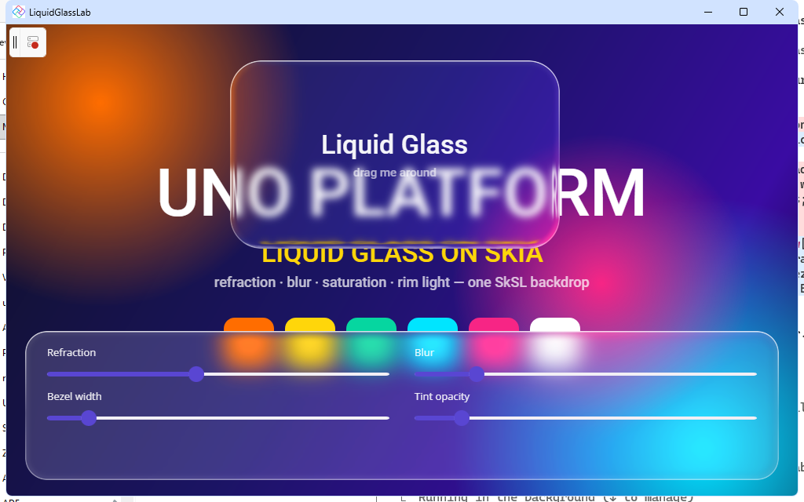

# LiquidGlassLab

Apple-style **Liquid Glass** for Uno Platform, rendered live on the Skia renderer. A draggable glass card refracts, blurs, and saturates whatever the app has painted behind it — no static snapshots, no platform-specific effects.



## How it works

`LiquidGlassView` ([Controls/LiquidGlassView.cs](LiquidGlassLab/Controls/LiquidGlassView.cs)) subclasses **`SKCanvasElement`** (`Uno.WinUI.Graphics2DSK`, pulled in automatically by the `SkiaRenderer` Uno feature). On Skia targets, `SKCanvasElement.RenderOverride` draws on *the same canvas the window renders to*, with everything behind the element already painted. That makes a true backdrop effect possible:

1. **Clip** to a rounded rect (the glass shape).
2. **`canvas.SaveLayer(in SKCanvasSaveLayerRec { Backdrop = filter })`** — SkiaSharp 3.119's binding of `SkCanvas::SaveLayerRec`. The backdrop filter chain re-initializes the layer from the already-painted content behind the element:
   - **Blur** — `SKImageFilter.CreateBlur`.
   - **Refraction** — `SKImageFilter.CreateDisplacementMapEffect`, displaced by an **SkSL runtime shader** (`SKRuntimeEffect` + `SKRuntimeShaderBuilder` → `SKImageFilter.CreateShader`). The shader computes a rounded-rect SDF; its gradient gives the outward normal, and a smoothstep ramp across a bezel band gives the lens profile. RG-encoded as `0.5 + n * 0.5`.
   - **Saturation boost** — color-matrix `SKColorFilter`, the "vibrancy" part of the Apple look.
3. **Tint wash** + **rim highlights** (gradient strokes) drawn on top.

SkiaSharp 3.119 has no binding for `SkImageFilters::RuntimeShader`, so the SkSL shader can't process the backdrop directly — routing it through the displacement-map filter as the *displacement input* is the workaround, and it's also cheaper (the shader is evaluated once per pixel as a plain shader).

## Performance model

`RenderOverride` runs on the render thread, potentially every frame while dragging, so the control never builds Skia objects per frame:

- The whole backdrop filter DAG, tint/rim/shade paints, and gradient shaders are **cached** and rebuilt only when a parameter or the element size changes.
- Dependency properties are **snapshotted to plain fields on the UI thread**; the render thread reads fields only and compares them to the built-with values — no cross-thread DP access.
- **Chromatic aberration** splits the displacement per channel (R bends more, B less) and recombines with arithmetic compose filters. The shared blur and lens-shader nodes are evaluated once by Skia's filter cache, so it costs three displacement passes over the glass area, not three full chains.
- Caches are dropped on `Unloaded` and rebuilt lazily.

## Gotcha worth remembering

`SKRuntimeShaderBuilder` must be **created once and cached**. Disposing it (e.g. `using var builder = ...` per frame) tears down native state shared with its `SKRuntimeEffect`; the next render then hits a native use-after-free (`0xC0000005` in `sk_runtimeeffect_get_uniform_byte_size`). Symptom: first frame fine, crash on the next invalidation (e.g. when dragging).

## Tunables (dependency properties)

| Property | Default | Effect |
|---|---|---|
| `GlassCornerRadius` | 28 | Shape of the glass slab |
| `RefractionStrength` | 40 | Max sample offset at the rim, px |
| `BezelWidth` | 24 | Width of the refracting edge band, px |
| `BlurRadius` | 6 | Backdrop blur sigma |
| `ChromaticAberration` | 0.4 | 0..1, per-channel refraction split at the rim |
| `TintColor` / `TintOpacity` | white / 0.10 | Glass tint wash |
| `SaturationBoost` | 1.35 | Backdrop vibrancy |

## Run it

```
dotnet run -f net10.0-desktop
```

Drag the card; tune the effect with the sliders in the bottom (also glass) panel.

## Scope

Works on all **Skia-rendered** Uno targets (desktop, and mobile/WASM with `SkiaRenderer`). On the Windows App SDK native target, `SKCanvasElement` is unsupported at runtime — gate with `SKCanvasElement.IsSupportedOnCurrentPlatform()` and fall back to `AcrylicBrush` if you need that head.

Validated on Uno.Sdk 6.5.36, net10.0-desktop, SkiaSharp 3.119.2 (2026-06-12).
